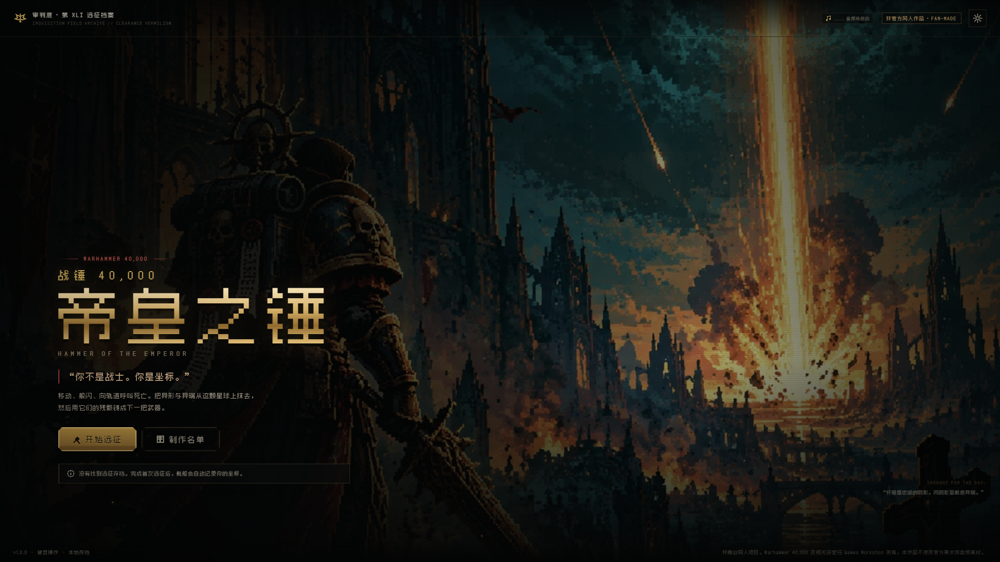
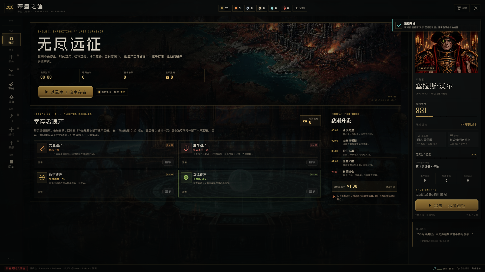
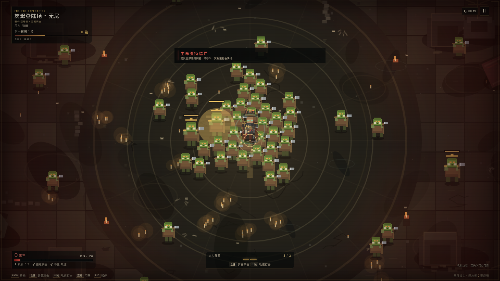
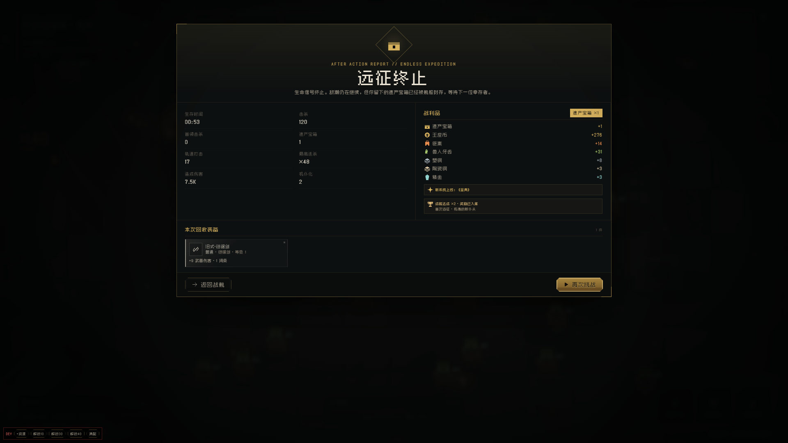
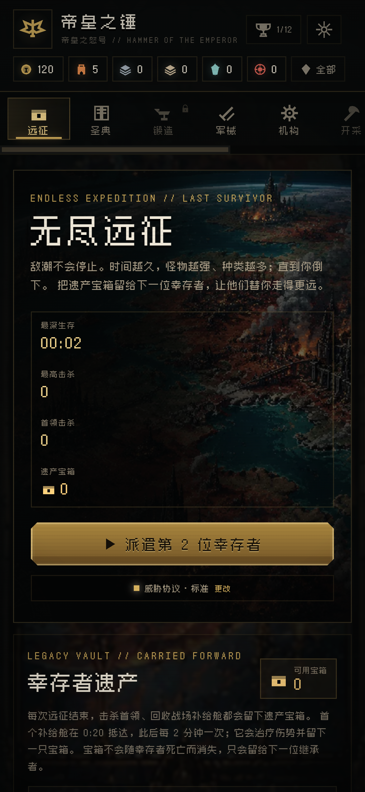
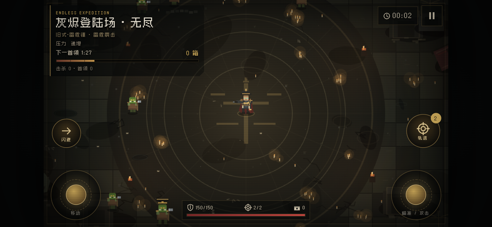

# 帝皇之锤 · Hammer of the Emperor

一款**非官方、非商业**的《战锤 40,000》同人像素增量 / 生存 Roguelite 网页游戏。

> “你不是战士。你是坐标。”

你是一名审判官，带着一艘在轨的打击巡洋舰降落到被异形与异端占据的星球。你不需要亲手杀光所有敌人——你的武器是待在上面的那艘船。移动、躲闪、用鼠标标记轨道打击坐标，把死亡从天上叫下来。

---

## 快速开始

```bash
npm install
npm run dev
```

打开终端提示的地址（默认 `http://127.0.0.1:5180`）。

生产构建：

```bash
npm run build
npm run preview
```

构建产物在 `dist/`。项目使用 Vite 的 `base: './'`，可以部署到任意静态目录。

**建议使用键鼠与桌面浏览器。** 游戏为固定 16:9 战场，支持宽屏缩放；移动端布局可用，但核心操作依赖 WASD + 鼠标。

### 截图

| 标题 | 舰桥 |
|---|---|
|  |  |

| 无尽战场 | 远征结算 |
|---|---|
|  |  |

---

## 主模式：无尽远征

游戏现在**只有无尽生存模式**，原 40 战区闯关模式已移除。

- **时间即难度**：敌潮不会停止。存活越久，敌人血量、伤害、数量与精英密度越高；没有胜利条件，直到审判官死亡。
- **敌潮升级**：0–2 分钟以兽人为主；2 分钟后加入泰伦；6 分 30 秒后混沌与钛族混入；9 分钟后千子、混沌与虫群同时入场。
- **限时首领**：1:30 出现第一位首领，此后每 2 分钟一位；首领轮换全部 4 种，并随轮次继续变强。
- **遗产宝箱**：首个补给舱在 0:20 抵达，之后每 2 分钟一次，会恢复 15% 生命并留下 1 只宝箱；每次击杀首领也会留下宝箱。撤退或死亡都会结算，宝箱存入舰船。
- **下一位幸存者**：舰桥的“幸存者遗产”用宝箱购买永久加成，当前有力量、生命、轨道、幸运四条遗产线，每线 10 级。宝箱与遗产跨幸存者保留。
- **四档威胁协议**：新兵 / 标准 / 老兵 / 灭绝令，分别改变敌人生命、伤害、密度和战利品倍率；设置内随时切换，下一场战斗生效。

所有舰载系统、装备、机构与星炬都改为由**无尽生存纪录**解锁；不再存在战区、净化配额、首通奖励或回刷。首领只作为无尽远征中的限时威胁出现。

---

## 操作

| 输入 | 作用 |
|---|---|
| `W A S D` / 方向键 | 移动 |
| 鼠标左键 | 朝光标方向使用当前武器攻击；按住可连续攻击 |
| 鼠标中键 | 在光标位置呼叫轨道打击，消耗 1 发火力配额 |
| `空格` / `Shift` | 战术闪避（短暂无敌） |
| `Esc` / `P` | 暂停 |
| 底部技能图标 | 点击可提前施放（技能也会自动施放） |

轨道打击有约 0.9 秒的落点延迟，并带有屏幕震动、冲击波、焦痕、粒子与命中停顿。齐射时多枚弹头会错开落地。

## 移动端

战斗采用**横屏 + 双摇杆**：

- 左侧虚拟摇杆：移动。
- 右侧虚拟摇杆：拖动方向瞄准，推住持续使用当前武器攻击。
- 「轨道」按钮：朝当前瞄准方向呼叫轨道打击，并显示剩余火力。
- 「闪避」按钮：战术闪避。
- 已学习的机构技能会显示在底部技能条，点击可提前释放。
- 顶部暂停按钮打开暂停/撤收菜单。

竖屏进入战斗时会显示横屏提示，可一键请求全屏与横屏锁定；部分 iOS 浏览器不支持锁定，需要手动旋转手机。舰桥、标题页、结算页和弹窗均做了移动端单列/换行布局，资源条在窄屏下会自动换行。

| 移动端舰桥 | 横屏战斗 |
|---|---|
|  |  |

---

## 已实现内容

### 战斗

- **唯一模式：无尽远征**：计时生存、敌潮升级、限时首领、死亡结算、遗产宝箱与永久遗产强化。
- 5 种异形 / 异端阵营：兽人、混沌、钛族、千子、泰伦。
- 5 个战斗机构、15 个技能：
  - 星际战士：爆弹齐射 / 速射协议 / 热熔炸弹
  - 机械教：机械猎犬 / 战斗机仆 / 伺服颅骨
  - 刺客庭：致命瞄准 / 穿甲弹 / 死神之眼
  - 星语庭：烈焰 / 闪电 / 霜寒圣典
  - 死灵科技：圣甲虫群 / 熵力场 / 坍缩奇点
- 手动左键武器攻击、中键轨道打击；按住左键可连续挥击，攻击方向跟随光标。
- **武器决定攻击方式**：链锯剑横扫、雷霆锤震击、风暴盾击、电浆爆裂、热熔喷射、战旗鼓舞各自拥有不同范围、冷却、伤害与特效。

| 武器 | 左键攻击 |
|---|---|
| 链锯剑 | 快速大范围锯齿横扫 |
| 雷霆锤 | 光标落点重砸，产生范围冲击波 |
| 风暴盾 | 前方盾击击退，并短暂无敌 |
| 电浆枪 | 发射会爆炸的电浆球 |
| 热熔枪 | 近距离锥形热流 |
| 战旗 | 战旗脉冲伤害并强化自身 |

- 武器美术同步：角色手中的武器会随装备切换，攻击朝向、挥击/枪口火光与命中特效保持一致。
- 暴击 / 双重伤害 / 三重伤害、武器范围与爆炸伤害等乘区。
- 火力配额：有限弹仓 + 调度回复；星炬仍可解锁自动轨道交战。
- 机仆化：击杀有概率把敌人改造成友方机仆，机仆死亡时爆炸。
- 轨道补给空投、医疗包、临时圣物增益。
- 4 种限时首领，按 1:30 / 3:30 / 5:30… 轮换入场，具有冲撞、震地、齐射与召唤等招式。
- 兽人枪手：从第 1 分钟开始进入无尽战场，用远程弹幕逼迫玩家移动。
- 连杀、屏幕震动、伤害数字、砍杀粒子、焦痕、低血量红屏等反馈。

### 成长与增量系统

- **《圣典》**：3 条分支、30 个节点、84 个可点亮等级，节点顺序解锁。
- **锻造**：6 种武器、4 种护甲、普通 / 精良 / 史诗 / 传说四档稀有度，随机词缀、强化（祝圣）、重铸、回收。
- **军械库**：武器 / 护甲装备槽、库存筛选、装备对比、品质与词缀展示。
- **机构**：5 个机构解锁、被动加成、主动机构切换；每个机构的 3 个技能需要单独消耗资源学习，之后再升级。
- **技能获取**：新幸存者没有初始技能。第一次远征后获得资源，在机构页用王座币与对应材料学习技能；只有当前机构中已学习的技能会进入战斗。
- **地表开采**：4 种矿物持续产出；离线最多结算 4 小时。
- **圣化**：3 个圣印槽，随机 I–III 阶圣印，可剥离。
- **星炬祝福**：8 个永久祝福，包含自动交战、额外配额与全局乘区。
- **12 种资源**：王座币、兽人牙齿、钛族合金、混沌遗物、灵能尘埃、虫族生物质、钷素、塑钢、陶瓷钢、精金、亚空间信标、大魔之血。
- **12 个游戏内成就**，覆盖生存时长、首领、遗产、传说装备与单场击杀等里程碑。
- 本地存档、自动保存、离线结算、重置确认。

### 数值

数值基线来自 `note/战锤40K_游戏策划案.md` 与 `note/NUMBERS.md`，并针对网页单局时长做了适配：

- 玩家伤害通过装备、圣典、机构、星炬与幸存者遗产多乘区叠加。
- 敌人基础血量/伤害与旧战役的成长曲线分离，无尽模式只使用时间轴：敌人血量约 `1 + 时间/110 + (时间/420)^2 × 0.6`，伤害约 `1 + 时间/220`。
- 同时按分钟提高刷新频率、精英概率与阵营层级；首领血量随轮次与时间继续放大。
- 四档威胁协议：新兵（敌 HP ×0.85 / 伤害 ×0.70）、标准（×1.00 / ×1.00）、老兵（×1.28 / ×1.45）、灭绝令（×1.60 / ×1.90）。
- 遗产加成：力量 +8% 伤害 / 级、生命 +8% 生命 / 级、轨道 +7% 轨道伤害 / 级、幸运 +8% 王座币 / 级，每线 10 级。

### 经济节奏

- 王座币是最常见的击杀收益，基础约 **1.1 / 击杀**；不再按旧的高倍率滚雪球。
- 阵营货币（兽人牙齿、钛族合金、混沌遗物、灵能尘埃、虫族生物质）只在约 12% 的击杀中出现，每次约 1 单位。
- 钷素 / 塑钢 / 陶瓷钢 / 精金的单次掉落率分别降至约 6% / 2.5% / 0.9% / 0.18%。
- 每次远征结束额外结算一笔打捞王座币：约 `15 + 时间/30×4 + 击杀/30`，保证短局也有基础收入。
- 技能学习：第 1 个约 60 王座币；第 2 个约 260 王座币 + 14 材料；第 3 个约 650 王座币 + 32 材料。升级费用另计，且明显更高。
- 成就奖励不再提供百万级王座币，只作为一次性里程碑补贴。
- 开采场基础产出减半，离线结算上限改为 4 小时；矿场升级成本也同步提高。

> 这是面向网页的垂直切片，而非对 273 属性 / 168 节点 / 9 机构的逐项复刻。核心循环、数值骨架、资源、装备、成长与机仆化均保留。

---

## 音频系统

所有音乐与音效都由 WebAudio 实时合成，不依赖外部音频文件。

- **4 套动态 BGM**：标题（低音管风琴与钟声）、舰桥（工业脉冲与低频舰体共鸣）、战斗（战鼓、贝斯、铜管式锯齿与高频琶音）、首领（更快战鼓、双踩、唱诗班与不谐和铜管）。
- 战斗 BGM 会随生存时间提高打击密度；进入首领战自动切换，首领死亡后交叉淡出。
- **40+ 种音效**：界面悬停/点击/确认/错误、轨道呼叫与坠落哨音、轨道爆炸与音乐闪避、爆弹枪、近战/技能、敌人命中/死亡、精英死亡、机仆化、治疗/护盾/圣物、闪避、受伤、锻造/圣化/升级/回收/装备、首领咆哮/预警/震地/齐射/冲锋/召唤、胜利/失败/成就/解锁。
- 音乐经过 compressor + 卷积混响总线；爆炸时自动闪避音乐，首领与战斗曲目交叉淡入淡出。
- 标题、舰桥页脚和设置中都有 **音频状态与电平表**；设置内可分别调音乐/音效音量，并提供「界面音 / 轨道打击 / 圣歌」试听。
- 浏览器要求一次用户交互才能启动音频：首次点击任意位置即可解锁；若标签页被静音，设置里的状态会显示「等待交互」。

---

## 美术管线

所有场景、阵营与首领肖像由统一 API 生成，脚本位于 `scripts/`，并且**只通过 `curl` 调用**：

```bash
# 1. 将 .env.example 复制为 .env.local，填入 IMAGE_API_KEY
# 2. 生成全部缺失图片（已存在的会跳过）
npm run art
# 或只生成指定 id
powershell -ExecutionPolicy Bypass -File scripts/generate-art.ps1 -Only hub_bridge,planet_map

# 3. 裁剪 / 压缩成 WebP
npm run art:optimize
```

- 模型与提示词清单：`scripts/art-manifest.json`（`gpt-image-2.5`）。
- 生成脚本：`scripts/generate-art.ps1`（`curl.exe`、BOM-free JSON、b64 解码、失败日志）。
- 图像优化：`scripts/optimize-art.mjs`（`sharp`，生成 `public/art/*.webp`）。
- 原始 PNG 与生成日志保存在 `art-raw/`（被 `.gitignore` 忽略）。
- 战斗中的审判官、异形、机仆、首领、弹道、轨道光柱、焦痕与粒子全部由 Canvas 2D 程序化绘制。

`.env.local` 仅用于本地生成，不会进入前端 bundle；`.env*` 已被忽略。

---

## 技术栈

- React 19 + TypeScript + Vite
- Canvas 2D 战斗引擎（固定 960 × 540 内部像素分辨率）
- WebAudio API 实时合成音乐与音效（无外部音频素材）
- localStorage 存档（键名：`hammer_of_the_emperor_save_v1`）
- 像素字体：**Zpix（最像素）** by SolidZORO（个人非商业项目许可）

### 目录

```text
src/
  game/
    data/          阵营、敌人、首领、技能、机构、圣典、星炬、装备、威胁协议、遗产
    engine/        Canvas 无尽战斗、程序化像素精灵、WebAudio
    meta/          存档、数值计算、行动（购买 / 锻造 / 升级 / 无尽结算 / 遗产）
  ui/              React 界面：标题、舰桥、无尽远征、圣典、锻造、军械库、机构、开采、圣化、星炬、图鉴、战斗 HUD、结算
  styles/          全局像素 UI
public/art/        AI 生成并优化后的 WebP 场景与肖像
public/favicon.svg
scripts/           统一 curl 美术生成、优化
note/              原始策划与逆向资料
```

---

## 开发者模式

在 URL 后加 `?dev=1` 会显示左下角调试条：

- `+资源`：每种资源 +1,000,000。
- `生存10 / 生存30 / 生存40`：把生存纪录设为对应分钟数，并发放 3 只遗产宝箱。
- `满配`：点亮全部圣典与星炬、解锁全部机构、技能 3 级、注入传说装备。

这些操作只修改当前本地存档，正式游玩时请使用不带 `?dev=1` 的地址。

---

## 制作与声明

- **非官方同人作品。** Warhammer 40,000、相关名称、设定与标志归 Games Workshop 所有。
- 本项目不收费、不接广告、不含官方美术 / 音频 / 文本素材。
- 场景与角色肖像由 gpt-image-2.5 通过统一 `curl` 管线生成；提示词和脚本可复现。
- 战斗像素精灵、特效、HUD 与界面为程序化绘制 / 手写 CSS。
- 像素字体：Zpix（最像素）by SolidZORO，个人非商业使用；如需商用请遵守其授权条款。
- 数值与系统参考 `note/战锤40K_游戏策划案.md`，亦参考了对 Zad Archery 的逆向分析资料。

愿帝皇保佑你的准星。
